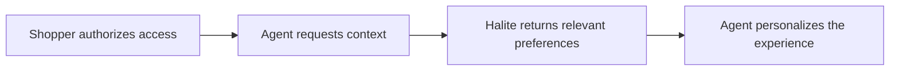

# Halite developer examples

Halite lets a shopper bring their beauty profile to any app or store, with their permission. Your app asks; they choose what to share; you get their preferences, routines and what has worked for them, and you personalize from the first visit.



1. **The shopper authorizes access.** Your app sends them to Halite's consent screen. They see your app's name, what it's asking for, and can untick anything.
2. **Your agent requests context.** With the access token, it asks for what they shared: preferences, interests, routines, what has worked for them.
3. **Halite returns relevant preferences.** Only the scopes and categories they granted, and never the names of products or brands they bought elsewhere.
4. **Your agent personalizes.** Rank your catalog for them, explain each pick, and leave out what they must avoid.

## What's here

| | |
|---|---|
| [`docs/authentication.md`](docs/authentication.md) | Keys, OAuth 2.0 with PKCE, tokens and refresh |
| [`docs/consent.md`](docs/consent.md) | Scopes, categories, disconnecting, and the webhooks that tell you |
| [`docs/context-api.md`](docs/context-api.md) | Reading a shopper's context, ranking products for them, sending events back |
| [`examples/shopping-agent`](examples/shopping-agent) | An agent that asks Halite about a shopper and picks products for them, in about 100 lines |
| [`examples/merchant-personalization`](examples/merchant-personalization) | A store page that ranks its catalog for a shopper who connects, with the full OAuth flow |
| [`sdk/typescript`](sdk/typescript) | `@haliteintelligence/sdk`: the server-side TypeScript client the examples use. Node 18+, no dependencies |
| [`openapi/openapi.json`](openapi/openapi.json) | The Developer API as OpenAPI 3.1, for generating clients in any language |

## Try it in five minutes

1. Sign in at [developers.haliteintelligence.com](https://developers.haliteintelligence.com) with your email (you get a code, no password). Create an organization, then an app.
2. On the app's **API keys** tab, create a **test** key and copy it. It's shown once.
3. Run the shopping agent against a sample shopper:

```sh
cd examples/shopping-agent
npm install
HALITE_SECRET_KEY=hk_test_… npm start
```

```
1. Authorized: hlp_test_… shared profile.read, preferences.read, interests.read, context.read

2. Halite says: dry skin that reacts easily, mainly working on dryness (also redness and barrier repair). …
   Never recommend: fragrance, essential oils, denatured alcohol
   Routine: Morning (am): cleanser → moisturiser → sunscreen

3. Picked for them:
   100%  Ceramide Barrier Cream ($28)
         ✓ Built on ceramides and squalane, which you gravitate to
         ✓ Targets dryness, which you said you're working on
   …
```

Test keys only ever reach six sample shoppers, so you can build and test without touching a real person's data.

## The same in a few lines

```ts
import { Halite } from '@haliteintelligence/sdk'

const halite = new Halite({ secretKey: process.env.HALITE_SECRET_KEY!, clientId: process.env.HALITE_CLIENT_ID! })

// 1. The shopper authorizes access
const { url, state, codeVerifier } = halite.oauth.authorizeUrl({
  redirectUri: 'https://your.app/callback',
  scopes: ['profile.read', 'preferences.read', 'offline_access'],
})
// …redirect to `url`; on the callback, check `state`, then:
const tokens = await halite.oauth.exchangeCode({ code, redirectUri: 'https://your.app/callback', codeVerifier })

// 2 + 3. Request context; Halite returns what they shared
const shopper = halite.consumer(tokens)
const { summary, highlights } = await shopper.summary()

// 4. Personalize: your catalog, ranked for them
const ranked = await shopper.rank(myProducts)
```

## Keys

Secret keys start with `hk_` and belong on your server only: never in a browser, a mobile app or a public repository. If one is pushed to a public GitHub repository, GitHub tells Halite and the key is revoked at once.

## More

- Full documentation: [developers.haliteintelligence.com/docs](https://developers.haliteintelligence.com/docs)
- Interactive API reference: [developers.haliteintelligence.com/docs/reference](https://developers.haliteintelligence.com/docs/reference)

## License

[MIT](LICENSE)
